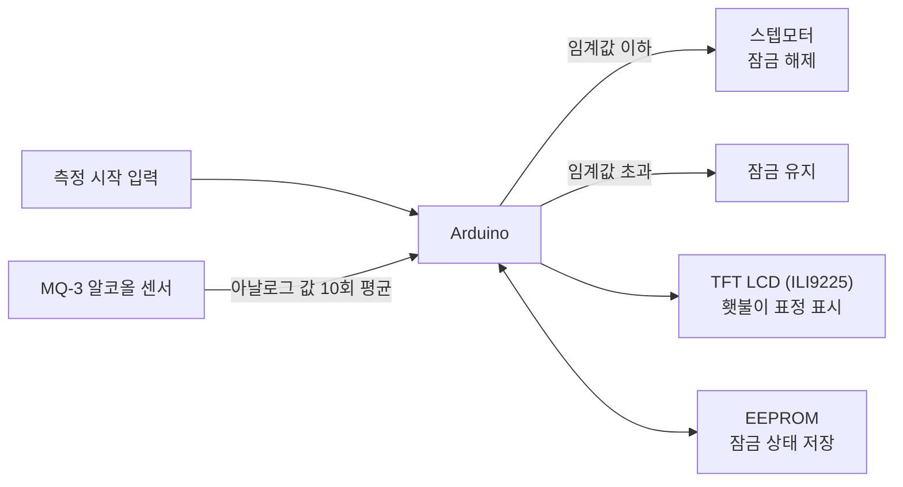

# 음주하면 횃 잠금!

> 음주 측정을 통과해야 잠금이 풀리는 전동 킥보드 잠금 장치

**2024 제9회 INU Maker 경진대회 장려상** · 창의설계입문
팀원: 강민수, 곽민지, 김민서, 이승후

---

## 문제 상황

전동 킥보드 이용이 늘면서 음주 운전 사례도 늘고 있습니다. 탑승 전에 음주 측정을 거치게 하면 사고를 줄일 수 있지 않을까 하는 질문에서 시작했습니다.

## 접근 방법

- 킥보드는 항상 **잠금 상태로 시작**하고, 음주 측정을 통과해야만 스텝모터가 잠금을 해제합니다.
- MQ-3 알코올 센서 값을 0.5초 간격으로 10회 읽어 평균을 내고, 임계값(400)을 넘으면 잠금을 유지합니다.
- 잠금 해제 상태를 EEPROM에 저장해, 전원이 다시 들어오면 자동으로 다시 잠급니다.
- LCD에 인천대 마스코트 횃불이 얼굴을 띄워 측정 대기·음주·통과 상태를 표시합니다.

**사람이 부는 바람과 자연 바람을 어떻게 구분할까**가 가장 큰 고민이었습니다.

| 시도 | 결과 |
| --- | --- |
| 압력 센서 | 배송 중 파손되어 사용하지 못함 |
| 이산화탄소 센서 | 값이 불안정. 내쉬는 바람에서 CO₂ 변화가 작다는 점을 고려하지 못함 |
| 스위치로 측정 시작 | 잠금 상태에서 시작하므로 측정 시작 입력 없이는 동작할 수 없다는 점을 이용해 채택 |

## 결과

- INU Maker 경진대회 장려상
- 심사 피드백: 사전 차단만으로는 상용화가 어렵고, 사용자 평균 무게와 주행 중 발생할 수 있는 문제까지 고려해야 한다는 의견을 받았습니다.

## 시스템 구성도

## 사용 기술

| 분류 | 내용 |
| --- | --- |
| 보드 | Arduino |
| 센서·구동 | MQ-3 알코올 센서, 스텝모터, 2.2" TFT LCD (ILI9225) |
| 소프트웨어 | Arduino C++ (Stepper, EEPROM, TFT_22_ILI9225) |
| 제작 | 아크릴 케이스, 횃불이 얼굴 3D 설계 |

## 코드

[`drunk_lock/drunk_lock.ino`](drunk_lock/drunk_lock.ino)

## 내 역할

- TODO

## 시연 영상 · 사진

- 시연 영상: [YouTube](https://youtube.com/shorts/tVj5QKrokwQ)
- 제작 기록: [Notion](https://evening-leech-00e.notion.site/_maker_-13878269aa8780edb01dfede212e50c0)

<!-- TODO: 작품 사진·회로도 이미지를 images/ 에 추가 -->
